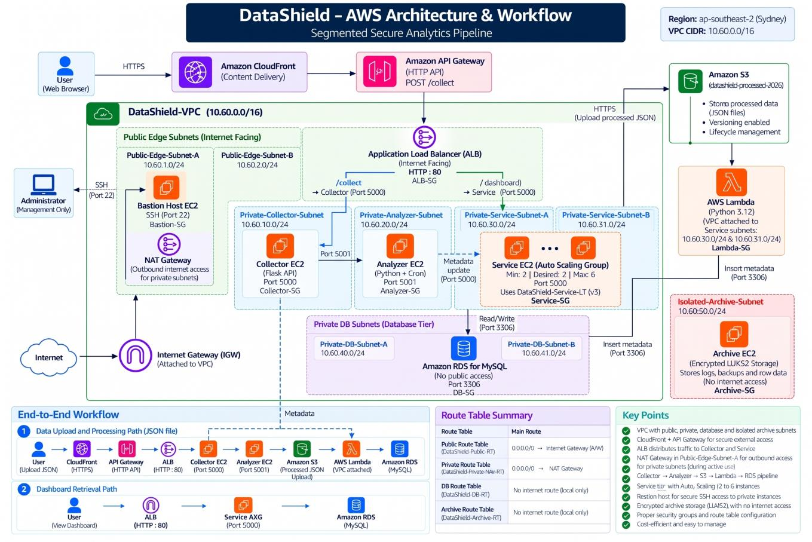

# DataShield – Segmented Secure Analytics Pipeline

Advanced Linux + AWS Networking capstone · **Harsha G** · IT Skill Nest (AWS & Linux Administration)

DataShield is a segmented, multi-tier analytics pipeline on AWS. JSON data enters through **CloudFront → API Gateway → ALB**, is validated by a private **Collector**, processed by an **Analyzer**, stored in **S3**, and an S3 event triggers a VPC-attached **Lambda** that writes to a private **RDS MySQL** database. A private, Auto-Scaled **Service** tier serves a dashboard from the database. An isolated, **LUKS2-encrypted Archive** keeps raw backups. Every communication path is intentional and enforced with routing and Security Groups.

> Academic/prototype project. It is **not** a production SIEM/IDS. Threat logic is rule-based and partly simulated.



## Highlights
- Custom VPC `10.60.0.0/16` with public, private, DB and isolated archive zones (2 AZs)
- IGW vs NAT routing; DB and Archive route tables are **local-only**
- Per-tier Security Groups, Bastion-only SSH, IAM roles (no static keys on instances)
- Flask services managed by **systemd**, scheduled backups via **cron**
- S3 versioning + lifecycle + SSE-S3 + public access blocked
- Event-driven **S3 → Lambda → RDS** (Python 3.12, PyMySQL)
- ALB + Launch Template + **Auto Scaling Group (min 2 / max 6)**
- Evidence: 31 screenshots in [`docs/screenshots`](docs/screenshots)

## Repository layout
```
├── collector/        Flask ingestion service, systemd unit, backup script + cron
├── analyzer/         Flask analyzer (S3 upload), cron metrics analyzer, systemd unit
├── service/          Flask backend + dashboard (templates/dashboard.html), systemd unit
├── lambda/           S3→RDS Lambda handler, build script
├── database/         schema.sql
├── archive/          LUKS2 encrypted volume setup
├── infrastructure/   network design, subnets, route tables, SG matrix
├── sample_data/      sample JSON payloads for testing the pipeline
├── scripts/          CORS config, test upload, pause/resume (cost)
├── docs/             report PDF, presentation, traffic flow, deployment, troubleshooting, screenshots
└── .env.example
```

## Quick start
1. Build the network and AWS services per [`docs/deployment-guide.md`](docs/deployment-guide.md).
2. Create the DB: `mysql -h <rds-endpoint> -u admin -p < database/schema.sql`
3. Deploy each tier's code and enable its systemd unit.
4. Package/deploy the Lambda: `cd lambda && ./build.sh`.
5. Test: `scripts/test_upload.sh https://<cloudfront-domain>/collect`, then open `http://<alb-dns>/dashboard-ui`.

Example payload: `{ "device_id": "DASHBOARD-UPLOAD-001", "value": 92.50 }` (more in [`sample_data/`](sample_data)). Upload a file from `sample_data/` through the dashboard, or send it with `scripts/test_upload.sh`.

## Security notes
- **No secrets in git.** The original code had a hard-coded RDS password; here all credentials come from environment variables (`.env.example`). **Rotate any password that was ever pasted into chats/notes.**
- The LUKS passphrase is never stored. Restrict Bastion SSH to your `/32`.
- `dashboard.html` embeds the CloudFront URL (`PIPELINE_URL`) – change it to your own distribution.
- Current ALB listener is HTTP/80; see future enhancements (HTTPS, auth).

## Source notes
| Component | Origin |
|---|---|
| `service/app.py`, `service/templates/dashboard.html` | Final versions from the project (DB credentials moved to environment variables) |
| `lambda/lambda_function.py` | Deployed function from `DataShield-Lambda.zip` (line endings normalised) |
| systemd units, 5-minute cron, SQL, LUKS2 steps | From the implementation notes |
| `collector/collector.py`, `analyzer/analyzer_server.py` | Reference implementations matching the documented behaviour and logs (see `docs/screenshots/20-*.png`, `21-*.png`) |
| `database/schema.sql` | Column names from the report; column types chosen to fit the data |

Sanity-tested locally: a payload of 96.69 flows Collector → Analyzer → S3 as `status: processed`, and invalid payloads return HTTP 400.

## Documentation
[Report (PDF)](docs/DataShield_Project_Report.pdf) · [Presentation](docs/DataShield_Presentation.pptx) · [Traffic flow](docs/traffic-flow.md) · [Network](infrastructure/network.md) · [Cost optimization](docs/cost-optimization.md) · [Troubleshooting](docs/troubleshooting.md)

## Future enhancements
HTTPS + custom domain · dashboard/API authentication · richer analytics · centralized logging · IaC (Terraform/CloudFormation) · automated tests · Secrets Manager · DR/restore testing

## License
MIT – see [LICENSE](LICENSE).
